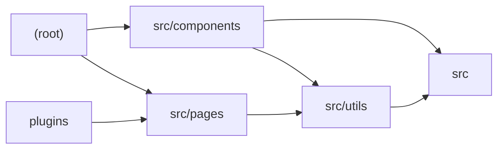

# Architecture

An Astro application with SolidJS chat UI components, Astro API endpoints, shared TypeScript models and environment typings, and utilities for request authentication and OpenAI-compatible streaming. Build configuration covers Astro adapters, UnoCSS, PWA support, and linting; a custom plugin transforms generation API code. Although some summaries mention Next.js, the described configuration and APIs use Astro conventions.

## Modules

| module | summary | AI |
| --- | --- | --- |
| `(root)` | Configures Astro, SolidJS integrations and adapters, UnoCSS, linting, and ambient declarations. | [AI] |
| `plugins` | Provides a build transform that strips marked Vercel-disabled blocks from the generation API. | — |
| `src` | Defines shared chat and error models plus Astro/Vite environment variable typings. | — |
| `src/components` | Implements the SolidJS chat interface, streaming conversation flow, settings, and message rendering. | — |
| `src/pages` | Exposes Astro endpoints for password validation and streaming chat completion requests. | [AI] |
| `src/utils` | Implements request-signature authentication and OpenAI-compatible payload and stream handling. | — |

## Module dependencies

_`[AI]` marks modules with AI/LLM touchpoints (prompt files, model API calls, agent logic)._
