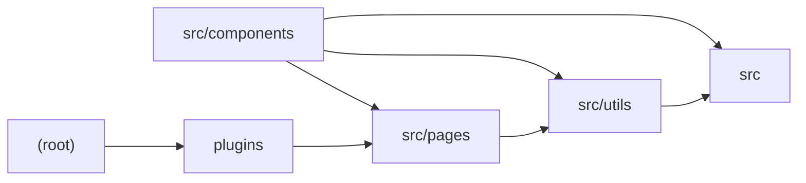

# Architecture

ChatGPT-API Demo is an Astro SSR application (not Next.js, despite the stated stack) using SolidJS islands for the UI, UnoCSS for atomic styling, and swappable deployment adapters (Node standalone, Vercel Edge, Netlify Edge). The browser-side Generator component builds a conversation, signs requests with a SHA-256 signature, and POSTs to /api/generate; that Astro API route verifies the signature and optional site password, builds a streaming OpenAI chat-completions payload via src/utils/openAI, and pipes the parsed SSE stream back to the client. A small Vite plugin strips deployment-specific code blocks from generate.ts for edge targets. Shared types (ChatMessage, ErrorMessage) and typed import.meta.env variables live in src.

## Modules

| module | summary | AI |
| --- | --- | --- |
| `(root)` | Astro, UnoCSS, ESLint and type shim configuration plus adapter selection for Node/Vercel/Netlify deployment. | [AI] |
| `plugins` | Vite pre-transform plugin that removes #vercel-disable-blocks sections from pages/api/generate.ts at build time. | — |
| `src` | Shared ChatMessage/ErrorMessage types and typed ImportMetaEnv declarations for OpenAI and site configuration. | — |
| `src/components` | SolidJS chat UI: Generator orchestrates streaming requests to /api/generate; MessageItem renders markdown; SystemRoleSettings/Slider configure prompt and temperature. | — |
| `src/pages` | Astro API routes for password auth and signed, streamed OpenAI chat completions. | [AI] |
| `src/utils` | OpenAI payload construction and SSE stream parsing, plus SHA-256 request signature generation/verification. | — |

## Module dependencies

_`[AI]` marks modules with AI/LLM touchpoints (prompt files, model API calls, agent logic)._
