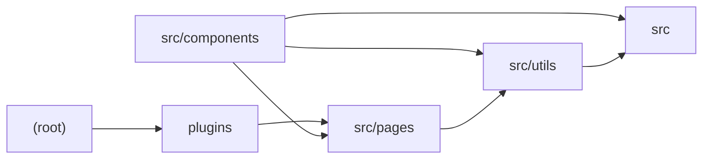

# Architecture

This is an Astro (SSR) + SolidJS chat web application that proxies chat completion requests to an OpenAI-compatible API and streams the assistant's reply token-by-token to the browser. The root module holds build/lint/styling configuration (Astro with Node/Vercel Edge/Netlify Edge adapters, UnoCSS, ESLint, JSX type shims), and a small Vite build plugin strips Vercel-incompatible code blocks from the generate API route. Shared contracts (ChatMessage, ErrorMessage) and typed environment variables live in src; SolidJS UI components in src/components manage conversation state, system prompt and temperature settings, markdown/KaTeX rendering, and SSE consumption from /api/generate; Astro API endpoints in src/pages handle password auth and the OpenAI proxy; and src/utils provides SHA-256 request signing plus OpenAI payload construction and SSE stream parsing. Note: several module summaries flag a stack contradiction — the codebase is Astro API endpoints using import.meta.env, not Next.js route handlers.

## Modules

| module | summary | AI |
| --- | --- | --- |
| `(root)` | Astro/UnoCSS/ESLint build configuration, deployment adapter selection, and JSX attributify type shims. | [AI] |
| `plugins` | Vite build plugin that removes '#vercel-disable-blocks' sections from pages/api/generate.ts for edge deployments. | — |
| `src` | Core TypeScript contracts (ChatMessage, ErrorMessage) and typed environment variables for OpenAI-compatible configuration. | — |
| `src/components` | SolidJS chat UI: conversation orchestration, SSE streaming from /api/generate, system prompt and temperature controls, markdown rendering, error/retry. | — |
| `src/pages` | Astro server API endpoints for password authentication and signed proxying of chat completions to the OpenAI-compatible API. | [AI] |
| `src/utils` | SHA-256 request signature generation/verification plus OpenAI payload building and SSE-to-text stream parsing. | — |

## Module dependencies

_`[AI]` marks modules with AI/LLM touchpoints (prompt files, model API calls, agent logic)._
