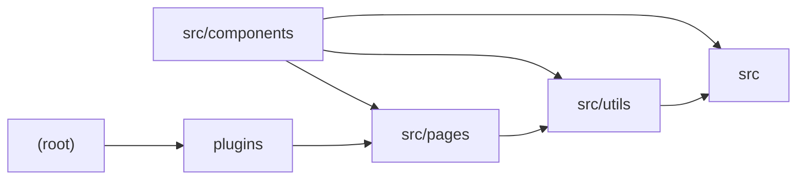

# Architecture

This repository is an Astro-based ChatGPT-style web application that uses Solid.js for interactive UI components, UnoCSS for styling, and server-side Astro API routes to proxy streamed chat completions from the OpenAI API. The root module configures the Astro build (with Node, Vercel Edge, and Netlify Edge adapters), UnoCSS design tokens, ESLint, and TypeScript shims. A small Vite plugin in `plugins/` strips Vercel-incompatible code blocks from the generate endpoint at build time. Shared types and environment variable declarations live in `src/`. The `src/components` module holds the Solid.js chat UI: a `Generator` controller that manages chat state, streams responses from `/api/generate`, and renders messages via `MessageItem` (Markdown, KaTeX, highlight.js), along with system-role/temperature settings, a Zag.js slider, error display, and SVG icons. `src/pages/api` exposes two POST endpoints: `auth` (site password check) and `generate` (signature/password verification, OpenAI payload construction, SSE streaming). `src/utils` supplies the SHA-256 signature helpers and the OpenAI payload builder and stream parser. Note: several module summaries flag that the project is Astro rather than Next.js, so Astro conventions (APIRoute, import.meta.env) apply throughout. An open security concern is that timestamp expiration in `verifySignature` is commented out, enabling replay of signed payloads.

## Modules

| module | summary | AI |
| --- | --- | --- |
| `(root)` | Astro/UnoCSS/ESLint/TypeScript configuration and deployment adapter selection. | [AI] |
| `plugins` | Vite plugin that strips '#vercel-disable-blocks' sections from the generate API route at build time. | — |
| `src` | Shared ChatMessage/ErrorMessage types and ImportMetaEnv declarations for OpenAI and site config. | — |
| `src/components` | Solid.js chat UI: Generator controller, Markdown message rendering, system role/temperature settings, slider, errors, icons. | — |
| `src/pages` | Astro API routes for password auth and streamed OpenAI chat completion generation. | [AI] |
| `src/utils` | SHA-256 request signing/verification and OpenAI payload construction plus SSE stream parsing. | — |

## Module dependencies

_`[AI]` marks modules with AI/LLM touchpoints (prompt files, model API calls, agent logic)._
