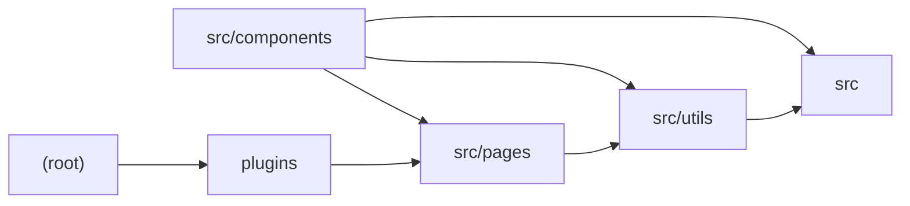

# Architecture

ChatGPT-API Demo is an Astro + SolidJS web chat client that proxies streaming chat completions to an OpenAI-compatible endpoint. The root module wires Astro integrations (UnoCSS, Solid.js, PWA) and selects a deployment adapter (Vercel Edge, Netlify Edge, or Node) at build time; a small Vite plugin strips Vercel-incompatible code blocks from the generate route. The `src` module declares shared types (ChatMessage, ErrorMessage) and typed `import.meta.env` variables. `src/components` holds the SolidJS UI (Generator orchestrates session state and streaming fetches to /api/generate; MessageItem renders Markdown/KaTeX/highlighted output; SystemRoleSettings and sliders configure the system prompt and temperature). `src/pages` exposes Astro API routes for password auth and signed, streamed generation requests, delegating payload construction and SSE parsing to `src/utils`, which also provides SHA-256 request signing. Note: the stack metadata claiming Next.js route handlers is contradicted by every module—the project is Astro with Vite-style environment variables.

## Modules

| module | summary | AI |
| --- | --- | --- |
| `(root)` | Astro/UnoCSS/ESLint/TypeScript configuration and multi-adapter deployment setup. | [AI] |
| `plugins` | Vite build plugin that removes #vercel-disable-blocks sections from the generate API route. | — |
| `src` | Shared TypeScript types (ChatMessage, ErrorMessage) and typed import.meta.env declarations for OpenAI config. | — |
| `src/components` | SolidJS chat UI: message state, Markdown/LaTeX rendering, system prompt and temperature settings, streaming response handling. | — |
| `src/pages` | Astro API endpoints for password auth and signed, streamed chat completion proxying. | [AI] |
| `src/utils` | Request signing/verification helpers and OpenAI payload construction plus SSE stream parsing. | — |

## Module dependencies

_`[AI]` marks modules with AI/LLM touchpoints (prompt files, model API calls, agent logic)._
