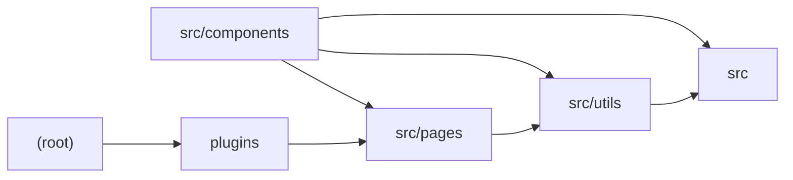

# Architecture

This repository is an Astro SSR chat application (not Next.js, despite earlier scan hints) that uses SolidJS for the client UI, UnoCSS for styling, and a Vite PWA integration. The root holds build/lint/style configuration plus a custom Vite plugin that strips Vercel-disabled code blocks from the generate API route. `src/types.ts` and `src/env.d.ts` define the shared ChatMessage/ErrorMessage models and typed `import.meta.env` variables for OpenAI-compatible endpoints. `src/components` contains the SolidJS chat UI (Generator, MessageItem, SystemRoleSettings, sliders, icons) which streams tokens from `/api/generate`. `src/pages/api` exposes Astro `APIRoute` POST handlers for site-password auth and for proxying chat completion requests to an OpenAI-compatible API. `src/utils` provides SHA-256 request signing/verification and OpenAI payload construction plus SSE stream parsing. Notable open items: the timestamp freshness check in `src/utils/auth.ts` is commented out (replay-attack risk), and the tail of Generator.tsx was truncated in analysis.

## Modules

| module | summary | AI |
| --- | --- | --- |
| `(root)` | Astro/UnoCSS/ESLint configuration and global JSX type augmentation for the SSR project. | [AI] |
| `plugins` | Vite build plugin that strips '#vercel-disable-blocks' delimited code from the generate API route. | — |
| `src` | Shared TypeScript types (ChatMessage, ErrorMessage) and typed import.meta.env declarations for OpenAI configuration. | — |
| `src/components` | SolidJS chat UI components for streaming generation, markdown/KaTeX rendering, system role and temperature settings. | — |
| `src/pages` | Astro APIRoute POST endpoints for password auth and proxying streamed chat completions to OpenAI-compatible APIs. | [AI] |
| `src/utils` | Request signature generation/verification and OpenAI payload building plus SSE stream parsing. | — |

## Module dependencies

_`[AI]` marks modules with AI/LLM touchpoints (prompt files, model API calls, agent logic)._
