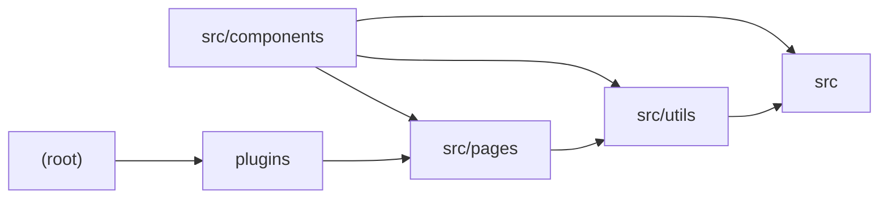

# Architecture

An Astro SSR + SolidJS chat application that proxies streamed chat completions to an OpenAI-compatible API. The root holds build/lint/styling configuration (Astro with environment-selected adapters, UnoCSS, ESLint, JSX attributify shims) and a custom Vite plugin that strips Vercel-incompatible blocks from the generate API route. `src` defines shared ChatMessage/ErrorMessage types and typed import.meta.env variables; `src/components` provides the SolidJS UI (Generator orchestrates conversation state, streams from /api/generate, and persists to session storage; MessageItem renders Markdown/KaTeX/highlighted code; SystemRoleSettings and Slider configure system prompt and temperature). `src/pages/api` exposes Astro APIRoute handlers for site-password auth and signature-verified generation, delegating to `src/utils` for SHA-256 signature generation/verification, payload construction, model selection, and SSE stream parsing. Note: despite any stated Next.js assumptions, the stack is Astro/Vite throughout (import.meta.env, APIRoute handlers, Node/Vercel Edge/Netlify Edge adapters). Open concerns: Generator.tsx was truncated in the input, and the timestamp expiry check in verifySignature is commented out, so signatures never expire.

## Modules

| module | summary | AI |
| --- | --- | --- |
| `(root)` | Project configuration: Astro SSR config with env-based adapters, UnoCSS presets/shortcuts, ESLint rules, and JSX attributify type shims. | [AI] |
| `plugins` | Vite/Rollup plugin that removes '#vercel-disable-blocks'…'#vercel-end' tagged code from pages/api/generate.ts at build time. | — |
| `src` | Core TypeScript types for chat/error messages and typed ImportMetaEnv declarations for OpenAI, proxy, password, and history settings. | — |
| `src/components` | SolidJS UI: chat orchestrator with streaming fetch to /api/generate, Markdown/LaTeX message rendering, error/retry, system prompt and temperature controls, SVG icons. | — |
| `src/pages` | Astro APIRoute endpoints for site-password authentication and signature-verified, proxied, streamed chat completions. | [AI] |
| `src/utils` | SHA-256 signature generation/verification plus OpenAI request payload building, model selection, and SSE-to-text stream parsing. | — |

## Module dependencies

_`[AI]` marks modules with AI/LLM touchpoints (prompt files, model API calls, agent logic)._
