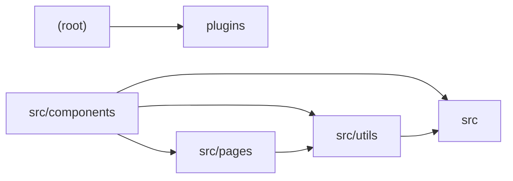

# Architecture

An Astro application using SolidJS for its chat UI, Astro API routes for authentication and generation, and utilities for request signing and OpenAI-compatible streaming. Root configuration selects deployment adapters and styling/build integrations. Although some stack descriptions mention Next.js, the supplied summaries and examples consistently indicate Astro, Vite, and import.meta.env.

## Modules

| module | summary | AI |
| --- | --- | --- |
| `(root)` | Configures Astro, deployment adapters, UnoCSS, PWA support, TypeScript shims, and linting. | [AI] |
| `plugins` | Provides a Vite transform plugin that removes marked code blocks from the generation API route. | — |
| `src` | Defines shared chat and error types plus client environment variable typings. | — |
| `src/components` | Implements the SolidJS chat interface, settings, message rendering, streaming state, and error handling. | — |
| `src/pages` | Exposes Astro API routes for password authentication and streaming chat generation. | [AI] |
| `src/utils` | Implements request signature helpers and OpenAI-compatible payload and SSE stream processing. | — |

## Module dependencies

_`[AI]` marks modules with AI/LLM touchpoints (prompt files, model API calls, agent logic)._
