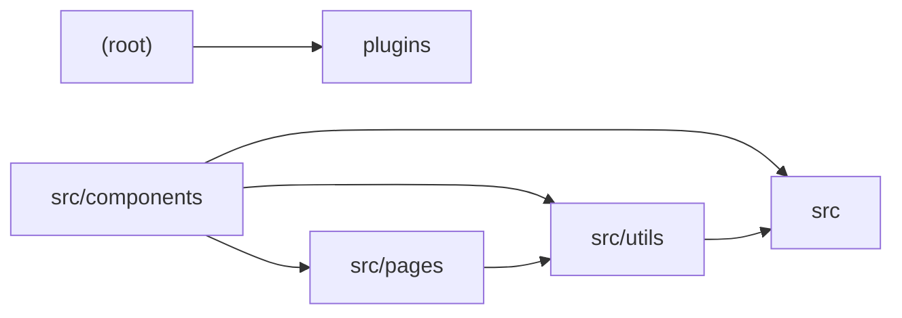

# Architecture

An Astro application with a SolidJS chat interface, Astro API routes for authentication and streaming chat completion, and utilities for request signing and OpenAI stream handling. Build configuration supports multiple deployment adapters and UnoCSS. Although some summaries mention Next.js, the described code and examples indicate Astro and Vite conventions.

## Modules

| module | summary | AI |
| --- | --- | --- |
| `(root)` | Configures Astro, SolidJS, UnoCSS, linting, TypeScript shims, and deployment adapters. | [AI] |
| `plugins` | Provides a build plugin that strips designated code blocks from the API generation route. | — |
| `src` | Defines chat and error data types plus typed environment variable interfaces for the application. | — |
| `src/components` | Implements the SolidJS chat UI, settings controls, message rendering, and error handling. | — |
| `src/pages` | Exposes Astro API routes for password authentication and streaming chat completion requests. | [AI] |
| `src/utils` | Implements request signature helpers and OpenAI request construction and stream parsing. | — |

## Module dependencies

_`[AI]` marks modules with AI/LLM touchpoints (prompt files, model API calls, agent logic)._
