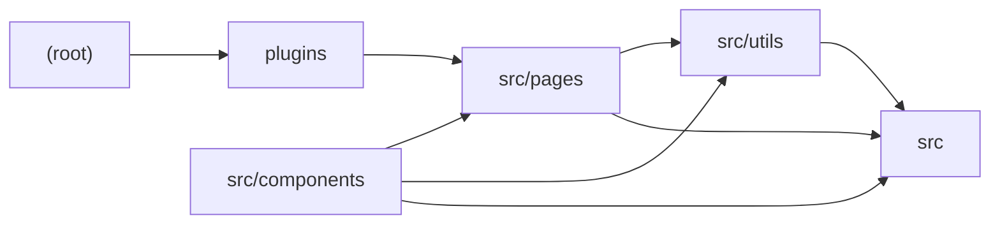

# Architecture

This is an Astro + Solid.js chat application that streams completions from an OpenAI-compatible API. The root configuration wires up Astro with UnoCSS, Solid, PWA support and selectable SSR adapters (Node, Vercel Edge, Netlify Edge), and installs a custom Vite plugin that strips Vercel-incompatible code blocks from the generate endpoint at build time. The `src/components` layer (Solid.js) owns conversation state, system-prompt/temperature settings and markdown rendering, and POSTs signed payloads to the `src/pages/api` Astro endpoints. Those endpoints validate passwords and request signatures via `src/utils/auth`, then use `src/utils/openAI` to build the streaming request and parse the SSE response into a readable text stream. Shared `ChatMessage`/`ErrorMessage` types and environment-variable typings live in `src`. Note: every module reports that the stack is Astro/Vite (import.meta.env, APIRoute) rather than Next.js route handlers. Open questions include how the client recovers from an abruptly dropped stream and whether the commented-out timestamp expiration in signature verification intentionally disables replay protection.

## Modules

| module | summary | AI |
| --- | --- | --- |
| `(root)` | Astro, UnoCSS, ESLint and TypeScript shim configuration including SSR adapter selection and PWA setup. | [AI] |
| `plugins` | Vite build plugin that strips '#vercel-disable-blocks' sections from pages/api/generate.ts. | — |
| `src` | Shared ChatMessage/ErrorMessage types and ImportMetaEnv typings for OpenAI configuration. | — |
| `src/components` | Solid.js chat UI: message history, streaming from /api/generate, system prompt and temperature settings, markdown rendering. | — |
| `src/pages` | Astro API routes for password auth and signed, streamed chat generation against an OpenAI-compatible endpoint. | [AI] |
| `src/utils` | Request signature generation/verification and OpenAI payload construction plus SSE stream parsing. | — |

## Module dependencies

_`[AI]` marks modules with AI/LLM touchpoints (prompt files, model API calls, agent logic)._
