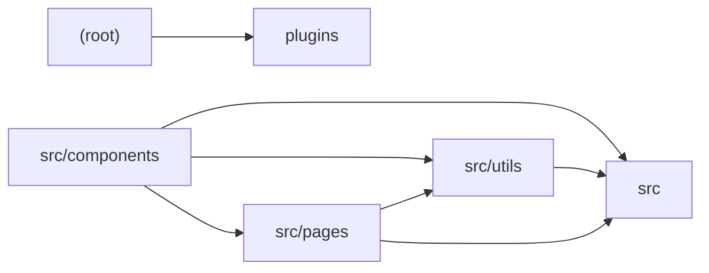

# Architecture

ChatGPT-API Demo is an Astro + SolidJS + UnoCSS web application that provides a streaming chat interface backed by an OpenAI-compatible chat completions endpoint. The root module holds build/lint/style configuration and selects a deployment adapter (Node standalone, Vercel Edge, or Netlify Edge). A small Vite plugin (`plugins`) strips marked code blocks from the generate API route for Vercel builds. The `src` module defines shared types (ChatMessage, ErrorMessage) and environment variable declarations. `src/components` contains SolidJS UI components (Generator, MessageItem, SystemRoleSettings, Slider, icons) that collect system prompts and temperature, sign requests, and stream model output into the UI. `src/pages` exposes Astro API routes (`/api/auth`, `/api/generate`) that validate passwords and signatures and proxy requests to the LLM provider. `src/utils` supplies SHA-256 signature generation/verification and OpenAI payload construction plus SSE stream parsing. Note: the codebase is Astro-based, not Next.js, and reads configuration via import.meta.env.

## Modules

| module | summary | AI |
| --- | --- | --- |
| `(root)` | Astro/SolidJS/UnoCSS build, lint, type-shim, and multi-adapter deployment configuration. | [AI] |
| `plugins` | Vite transform plugin that strips '#vercel-disable-blocks' sections from pages/api/generate.ts. | — |
| `src` | Shared TypeScript types (ChatMessage, ErrorMessage) and environment variable declarations. | — |
| `src/components` | SolidJS chat UI: streaming generator, markdown/code message rendering, system prompt and temperature controls, error display. | — |
| `src/pages` | Astro API routes for password auth and signed, streaming chat completion proxying. | [AI] |
| `src/utils` | Request signature hashing/verification and OpenAI payload construction plus SSE stream parsing. | — |

## Module dependencies

_`[AI]` marks modules with AI/LLM touchpoints (prompt files, model API calls, agent logic)._
